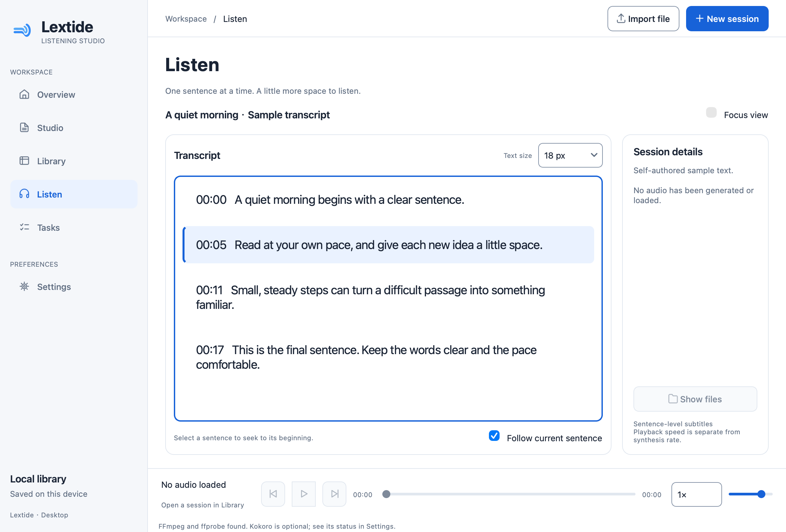
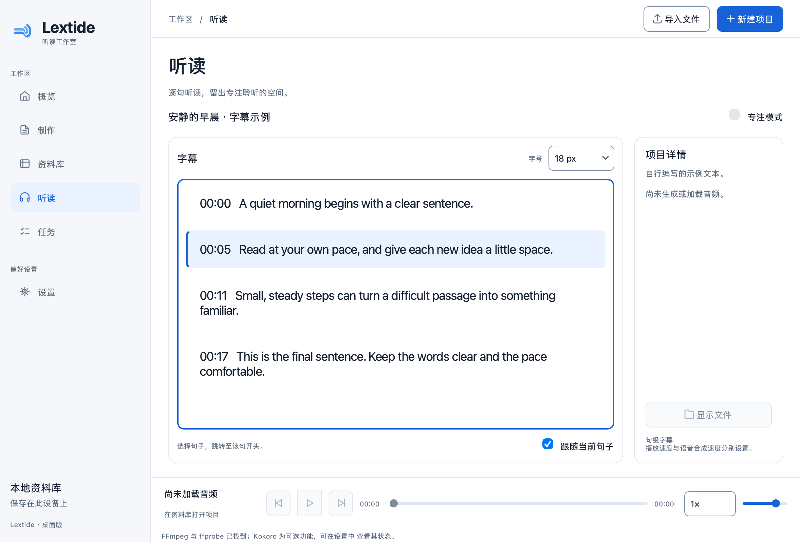

# Lextide 

**A Text-to-Speech and Listening Studio.**

Turn written content into natural speech, synchronized subtitles, and a focused listening experience.

Lextide is a Python learning project for macOS: prepare a reading script, explicitly approve online speech or use an optional offline engine, and keep the resulting MP3 and sentence-level SRT on your own computer. The interface supports **English and 简体中文**.

**0.6.1 is the first public source release.** G1–G6 passed independent engineering validation and user acceptance; the two G6 findings in Edge quotation metadata and mixed English/Chinese preparation were retested and are closed (`G6_PASS` / `USER_ACCEPTED`).

**This working tree is the 0.9.0 stable release candidate (`G9_STABLE_RELEASE_CANDIDATE`).** It adds text checks before synthesis and simplifies English extraction, while retaining one-click generation, Auto engine selection, immediate interface-language changes and manually supplied Chinese subtitles. Independent testing and user acceptance are still required; this candidate is not a claim that v0.9.0 has been published. See the [0.9.0 release notes](docs/release/G9_RELEASE_NOTES.md).

The source code is released under the [MIT License](LICENSE). Brand artwork is reserved and governed by [TRADEMARKS.md](TRADEMARKS.md); the exact asset scope is in [ASSETS_LICENSE.md](ASSETS_LICENSE.md). This release is **source only** — it does not include, and does not authorize, a public `.app` distribution.




These screenshots show the accepted 0.6.0 interface, not the current layout. Current text processing, generation and language behavior is described below.

## What it does

- Native PySide6 desktop: Overview, Studio, Library, Listen, Tasks and Settings.
- Local TXT, Markdown, DOCX and **text-layer** PDF import; preserved source and editable speech previews.
- **Text Processing → English Only / 文本处理 → 仅英文** immediately prepares an editable local preview using the existing translation-removal rules. It recognizes bounded translation spans, including joined bilingual text and translations containing names or numbers. Uncertain passages remain visible for review; synthesis with an English voice is blocked while Chinese text remains. This is not automatic translation or a general language detector. The conservative and enhanced Python cleaning APIs remain available.
- Review the visible reading text, then explicitly choose **Send to Edge & Generate** for each online run. Each click captures a fresh text/settings snapshot and SHA-256; changes during preparation invalidate that click.
- Kokoro ONNX offline speech with separately installed runtime and verified models; no silent online fallback.
- Long-document chunks, validated raw PCM cache, pause/cancel/resume, atomic local exports and historical manifest compatibility.
- Local MP3 playback with sentence subtitles, adjustable transcript size (12–40 px), light/dark themes.
- **English Only** (default) or **English + Chinese** subtitle display; import an existing Chinese SRT/TXT, review every mapped cue before saving, and edit Chinese text per cue. Translations stay in separate local JSON; the English SRT and audio remain unchanged.

**Not implemented:** screenshot/image OCR, scanned-PDF OCR, automatic subtitle translation, word-level alignment, cloud accounts, auto-updates and Windows packaging. OCR text obtained elsewhere can be pasted into Studio. Windows development is a separate future project.

## Run from source on macOS

The native development bundle is built for **Apple Silicon (arm64)**; current acceptance evidence is from macOS 27.0.1. The bundle declares macOS 13 as its minimum, but older macOS and Intel are not yet verified.

Install Python **3.12–3.14**, [uv](https://docs.astral.sh/uv/getting-started/installation/) and FFmpeg/ffprobe using your preferred trusted source. Python 3.13 is a useful choice if you also plan to install Kokoro's separate runtime. No administrator permissions are requested by Lextide.

From a local copy of this source directory:

```bash
uv sync --frozen --extra desktop --group dev
.venv/bin/lextide gui
```

The GUI uses `~/Library/Application Support/Lextide/desktop`. For an isolated trial:

```bash
.venv/bin/lextide gui --data-dir "$PWD/.artifacts/my-trial"
```

`--data-dir` selects a different local workspace, including its preferences, Library roots and Chinese subtitle attachments. An isolated trial may therefore show an empty Library; it does not delete exports in the normal workspace. Use the original data directory or choose the existing export folder in Library. This explains the workspace difference recorded as `OBS-G7-4`.

In Settings, select the actual FFmpeg and ffprobe executables if discovery cannot find them. Lextide does not install system packages or assume Homebrew paths. Qt Multimedia supplies the player; synthesis and integrity checks also require external FFmpeg/ffprobe.

### Language, text size and preparation

1. **Settings → Language / 语言 → English or 简体中文 → Save Settings.** The language changes immediately after saving. A language-only save keeps the current editor, selection, engine settings, task and player instances. Existing settings default to English.
2. **Listen → Text size** is a non-editable dropdown, default 18 px. Selection applies immediately and is saved automatically; it only changes the display.
3. **Studio → Text Processing:** choose **Keep Original / 保留原文** or **English Only / 仅英文**. Selecting English Only prepares the English preview locally; no separate Cleaning Mode selection is needed. Review the result before generating. Replacing a manually edited draft requires confirmation, and the original is retained.
4. The original remains available. Replacing an edited draft asks for confirmation and remains undoable. Expand **Review changes / 查看更改** for details, then check the visible **Reading text / 朗读文本**. Ready Kokoro runs use **Generate Audio**; Edge runs use **Send to Edge & Generate** beside the explicit upload notice. Local preparation checks that the click's exact text and settings remain current. If normalization changes the text, the result is shown and a new click is required before anything is sent.

See [text preparation rules and limits](docs/TEXT_PREPARATION.md). The enhanced rules can remove clear translations adjacent to completed English sentences or separated by `|` / `：`, including repeated names and numbers inside those translations. They do not delete an entire mixed line solely because its Chinese-character ratio is high. Ambiguous mixed text, Chinese names that belong inside English sentences, unfamiliar scripts and uncertain OCR breaks require manual review. A Chinese-only document does not produce invented English; an empty result cannot synthesize. The GUI and submission boundary check the final draft before starting: retained Chinese must be edited before an English voice or English Only request can run. The check does not silently change approved text or use a global Chinese ban for other-language voices.

### Existing Chinese subtitles

1. Open an existing verified export in **Listen**. The subtitle display starts as **English Only**; **English + Chinese** is saved independently of the interface language and theme.
2. Import a Chinese **SRT** whose cue numbers, cue count and every timestamp exactly match the English SRT, or a UTF-8 **TXT** with one non-empty line per English cue. TXT line count establishes an order only: **manually check that each line translates the corresponding English cue**.
3. Review the complete English/Chinese mapping and explicitly confirm before saving. Cancel leaves the current translation unchanged. Use the per-cue editor to correct or add Chinese for one cue. It rejects blank text; other cues may remain untranslated.
4. In bilingual mode, English remains visible for every cue. A missing Chinese translation does not interrupt playback. Both languages use the English cue's existing timing, seek, highlight and follow behavior.

Chinese text is stored under the desktop data directory's `translations/`, bound to the exact English SRT SHA-256 and cue identities. Changing the English SRT invalidates that attachment; it must not silently reuse a translation from another version. This feature does not generate, upload or automatically translate text. See the [Chinese subtitle guide and format rules](docs/BILINGUAL_SUBTITLES.md).

### Online and offline engines

| | Edge Online | Kokoro Offline |
|---|---|---|
| Default voice / rate | `en-US-GuyNeural` / `-4%` | `af_heart` / `-4%` |
| Network | The approved speech text and voice parameters are sent to Microsoft Edge TTS | Inference runs without text upload |
| Setup | Base dependencies + FFmpeg | Separate Python 3.13 environment, model, voices + FFmpeg |
| Availability | Depends on the remote service; no service guarantee | Depends on installed local runtime/models |
| Failure | Clear failure; valid completed chunks can be resumed | No automatic online fallback |

**Auto** is a third, explicit selection. It checks Edge connectivity through a voice-catalogue request that contains no document text. A successful check does not guarantee synthesis availability. Auto selects Edge when the check and local prerequisites succeed; otherwise it may select an already-ready Kokoro. It preserves the displayed voice and rate, so generation stays blocked until they are compatible with the chosen engine. Once synthesis starts, errors never trigger an automatic switch to another engine. Explicit Edge and Kokoro selections keep their existing meaning.

Kokoro installation is optional. Use an existing Python 3.13 interpreter; if absent, install it explicitly first:

```bash
UV_PYTHON_DOWNLOADS=never uv sync --project offline-runtime --frozen --python python3.13
.venv/bin/lextide models status --model-dir .models
# Explicitly authorize model download after reviewing the displayed sources and sizes:
.venv/bin/lextide models install --model-dir .models --allow-download --retries 2
.venv/bin/lextide models verify --model-dir .models
```

Then select the model root and `offline-runtime/.venv/bin/python` in Settings (use absolute paths through the file chooser). The base app does not include the offline model/runtime. Existing model directories can be reused. Model/voice identities and SHA-256 are pinned in [`model_catalog.py`](src/lextide/model_catalog.py). Kokoro output is **not byte-for-byte deterministic**: request cache keys and actual audio hashes have different roles.

## CLI examples

The old `tts-studio` alias remains available. CLI output and persisted diagnostic codes are stable; GUI language only affects the GUI.

```bash
.venv/bin/lextide --help
.venv/bin/lextide --version
.venv/bin/lextide preview --text "A quiet room helps me focus."

# Preview/review the printed text, then type YES in an interactive terminal:
.venv/bin/lextide synthesize --text "A quiet room helps me focus." \
  --out-dir .artifacts/short --allow-online

.venv/bin/lextide long --engine kokoro --input examples/long_english.txt --preview
.venv/bin/lextide long --engine kokoro --input examples/long_english.txt \
  --out-dir .artifacts/jobs --cache-dir .artifacts/chunks --model-dir .models \
  --offline-python "$PWD/offline-runtime/.venv/bin/python" --timeout 300

# Substitute a real task/job path printed by the command:
.venv/bin/lextide tasks status /path/to/task-ID
.venv/bin/lextide tasks resume /path/to/task-ID --allow-online
.venv/bin/lextide verify /path/to/task-ID/exports/job-ID
```

Use Ctrl-C for safe pause; `tasks cancel` persists a cancellation request. Resuming online tasks requires **fresh** online permission and text review. GUI text preparation is optional and does not silently alter CLI input. Use `--help` on a subcommand for supported limits and options.

## Development bundle

```bash
uv sync --frozen --extra desktop --group dev --group bundle
.venv/bin/python scripts/build_macos.py --output "$PWD/.artifacts/build-0.9.0"
open "$PWD/.artifacts/build-0.9.0/dist/Lextide.app"
```

The output directory must be new. The builder records the commit, source hashes, bundle inventory and ZIP SHA-256. Python, Qt, icons and translation resources are bundled; **FFmpeg command-line tools and Kokoro runtime/models remain external**. No data belongs inside `.app/Contents`.

This is an ad-hoc development bundle: **SIGNING_PENDING / NOTARIZATION_PENDING / LICENSE_REVIEW_PENDING**. Gatekeeper may block it; it is not a signed/notarized public installer. Source publication does not require buying Apple Developer Program. See [build/install/runtime guidance](docs/release/G5_RELEASE.md) and [license audit](docs/release/G5_LICENSE_AUDIT.md). Do not disable system protection to test distribution.

## Tests and learning

For the core-only offline CI environment (without Qt, Kokoro models or network TTS):

```bash
uv sync --locked --no-default-groups --group dev --python 3.13
```

Run the explicit offline subset in [CONTRIBUTING](CONTRIBUTING.md), or the current
[GitHub Actions workflow](.github/workflows/ci.yml). To include the desktop
tests below, use the desktop installation command above first.

```bash
.venv/bin/ruff check src tests scripts packaging/macos/launcher.py
.venv/bin/ruff format --check src tests scripts packaging/macos/launcher.py
.venv/bin/python -m compileall -q src
mkdir -p .artifacts
QT_QPA_PLATFORM=offscreen .venv/bin/pytest --basetemp=.artifacts/local-pytest
```

Pytest blocks socket/DNS traffic. Tests use mocks for TTS plus small generated PCM fixtures when FFmpeg is available. A mock does not establish real service reliability or audio quality. The minimal GitHub Actions workflow runs lint, compile and an explicit offline subset without models, credentials or text uploads. Real GUI/TTS/installation acceptance remains separate.

Start reading with the [Python learning guide](docs/LEARNING_GUIDE.md), then the [contribution guide](CONTRIBUTING.md). Main interfaces:

- [`desktop/controller.py`](src/lextide/desktop/controller.py): view actions and review/consent gates.
- [`desktop/service.py`](src/lextide/desktop/service.py): Qt-free worker boundary and local document provenance.
- [`cleaning.py`](src/lextide/cleaning.py): deterministic, source-preserving English preparation.
- [`reading.py`](src/lextide/reading.py): non-mutating text checks before an English reading request can be submitted.
- [`desktop/bilingual.py`](src/lextide/desktop/bilingual.py): subtitle attachment identity, import validation and independent local translation storage.
- [`engines/base.py`](src/lextide/engines/base.py): the small engine Protocol.
- [`longform/`](src/lextide/longform): chunks, cache, durable tasks and PCM assembly.
- [`audio.py`](src/lextide/audio.py), [`subtitles.py`](src/lextide/subtitles.py): integrity and timing validation.

## Privacy, licenses and limits

Source documents, prepared drafts, Chinese subtitle attachments, task files, cached PCM and exported audio stay local unless the user explicitly approves online TTS. A new Studio run uses the visible **Reading text**, the upload notice and **Send to Edge & Generate** to authorize one fresh snapshot; permission is not saved for reuse. Resuming a saved online task still opens the separate confirmation dialog with that task's exact text and SHA-256, starting unchecked; the editor may contain different text. There is no telemetry or automatic content upload. Task folders contain private text; do not publish them or full diagnostic records.

`.artifacts`, virtual environments, models, audio, app bundles and local handoffs are excluded from source publication. Integrity hashes detect changes but are not signatures against simultaneous malicious changes to both file and manifest. New clean-text metadata lives in an optional `document-review.json` field; historical schema 1/2/3 artifacts remain readable.

**Code license:** [MIT](LICENSE) — Copyright (c) 2026 Mingjia Liu. You may use, study, modify, redistribute and commercially use the original project code under MIT.

**Brand and artwork:** the Lextide name, application icon and brand symbol are **not** MIT-licensed. They are reserved under [TRADEMARKS.md](TRADEMARKS.md) and [ASSETS_LICENSE.md](ASSETS_LICENSE.md): personal and non-commercial educational use is permitted, commercial use as another product's brand needs written permission. Functional UI icons and design tokens are MIT-compatible so the interface stays reusable.

**Third-party material** keeps its own terms — see [THIRD_PARTY_NOTICES](THIRD_PARTY_NOTICES.md) and the per-file [asset release manifest](docs/release/ASSET_RELEASE_MANIFEST.md). Optional downloads do not remove GPL/LGPL or model-license obligations.

Author: **Mingjia Liu** · Contact: **mingjial@smu.edu** · GitHub: <https://github.com/adlerliu27-ai>

Automatic translation remains future work. Any future online translation needs its own explicit upload permission. No translation service or model is installed by Lextide.
